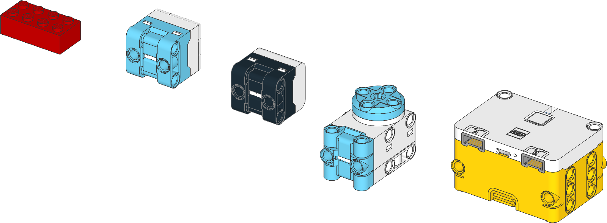
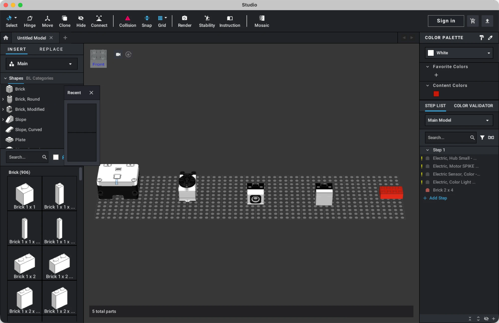

# brick-mcp

让 AI 助手（Claude Desktop 等）直接创建、查看和修改乐高模型的 [MCP](https://modelcontextprotocol.io/) 服务器，支持 BrickLink Studio 的 `.io` 文件和 LDraw 的 `.ldr` / `.mpd` 文件。

An MCP server that lets AI assistants create, inspect and edit LEGO models in BrickLink Studio and LDraw files. This fork adds macOS support without Nix, better Studio compatibility, and SPIKE part search.

> Fork 自 [datakurre/brick-mcp](https://github.com/datakurre/brick-mcp)，核心功能来自原作者。上游仓库没有许可证文件，复用或分发前请留意这一点。

## 效果

AI 通过 MCP 搭建并渲染的 SPIKE Essential 零件（从右到左：主机、小型角度马达、颜色传感器、光矩阵，以及一块 2×4 砖）：



生成的 `.io` 文件在 BrickLink Studio 中打开：



## 功能

- 打开和保存 `.io`、`.ldr`、`.mpd` 文件，保存的 `.io` 可以直接用 Studio 打开
- 添加、删除、移动、旋转零件和修改颜色，支持批量操作
- 查看零件清单（BOM）和搭建步骤，增删步骤
- 碰撞检查和放置校验
- 搜索 LDraw 零件库（约 2.5 万个零件）
- 渲染 PNG 预览图，并保存为文件

### 这个 fork 新增的内容

| 方面 | 改进 |
|---|---|
| **运行环境** | 不用 Nix 也能在 macOS 上加载完整零件库和渲染 |
| **Studio 兼容** | 保存时写入 Studio 必需的 `.info`，并在 LDraw 和 Studio 的零件编号之间双向转换，避免零件显示成"?" |
| **效果图** | MCP 返回的图片只有 AI 能看到，所以渲染结果会存成 PNG 并返回路径，也可以直接用系统看图软件打开 |
| **搜索** | 结果按相关度排序，词序不限，兼容 color/colour，支持 `spike hub`、`45609` 这样的乐高名称和编号 |
| **零件尺寸** | 名称里没有尺寸的零件（如电子件）按实际模型计算 |
| **渲染频率** | 默认不再每步渲染，减少等待和对话占用 |

## 安装（macOS，不用 Nix）

需要 Python ≥ 3.14。下面用 conda，其他虚拟环境同理。

**1. 安装 brick-mcp**

```bash
git clone https://github.com/makerseed201808/brick-mcp.git ~/brick-mcp
```

```bash
conda create -y -n brick-mcp -c conda-forge python=3.14
```

```bash
conda run -n brick-mcp python -m pip install -e ~/brick-mcp
```

**2. 下载 LDraw 零件库**（约 140 MB，解压后约 550 MB）

```bash
mkdir -p ~/ldraw && curl -fL -o ~/ldraw/complete.zip https://library.ldraw.org/library/updates/complete.zip
```

```bash
cd ~/ldraw && unzip -q complete.zip
```

没有零件库也能运行，但只能搜到约 80 个常用零件。

**3. 安装 LDView（用于渲染，可选）**

从 [LDView 发布页](https://github.com/tcobbs/ldview/releases) 下载 macOS 的 `.dmg`，把 `LDView.app` 拖到 `/Applications` 或 `~/Applications`。

**4. 安装 BrickLink Studio（可选）**

装在默认位置 `/Applications/Studio 2.0` 时会自动识别，零件编号转换依赖它的零件表。

**5. 配置 Claude Desktop**

先**完全退出 Claude Desktop（⌘Q）**，再编辑 `~/Library/Application Support/Claude/claude_desktop_config.json`，保留其他已有内容，然后重新打开。App 运行时可能会重写这个文件，把你的修改覆盖掉。

路径要写绝对路径，并把 `YOU` 换成你的用户名；`command` 用 `conda run -n brick-mcp which python` 输出的路径。

```json
{
  "mcpServers": {
    "bricks": {
      "command": "/opt/anaconda3/envs/brick-mcp/bin/python",
      "args": ["/Users/YOU/brick-mcp/main.py"],
      "env": {
        "LDRAW_COMPLETE_ZIP": "/Users/YOU/ldraw/complete.zip"
      }
    }
  }
}
```

### 环境变量

| 变量 | 作用 |
|---|---|
| `LDRAW_COMPLETE_ZIP` | LDraw `complete.zip` 的路径 |
| `LDRAW_DIR` | 解压后的零件库目录，供 LDView 使用（默认取 zip 旁边的 `ldraw/`） |
| `LDVIEW_BIN` | LDView 程序路径 |
| `STUDIO_DIR` | Studio 安装目录（默认 `/Applications/Studio 2.0`） |
| `BRICK_MCP_AUTO_RENDER` | 设为 `1` 时每次编辑都附带渲染图（默认关闭） |

### 使用 Nix

原作者推荐的方式，会自动处理依赖，但下面的命令运行的是上游版本，不包含这个 fork 的改动：

```json
{
  "mcpServers": {
    "bricks": {
      "command": "nix",
      "args": ["run", "github:datakurre/brick-mcp"]
    }
  }
}
```

## 使用示例

直接用自然语言告诉 AI：

> 用 SPIKE Essential 的主机和两个马达搭一辆小车，保存到 ~/Documents/car.io，然后渲染给我看。

底层的调用流程大致是：

```text
search_parts("spike hub")                      查找零件
get_part_footprint("67351c01")                 查询尺寸
batch([...add_part..., check_overlaps, ...])   批量搭建并检查碰撞
save_model("~/Documents/car.io")               保存，并生成 car_preview.png
render_model(open_in_viewer=True)              渲染并打开图片
```

### SPIKE 零件

LDraw 的零件名里没有 "SPIKE" 字样，但下面这些搜索词都能找到对应零件：

| 零件 | 搜索词 | LDraw 编号 | Studio 编号 |
|---|---|---|---|
| Essential 主机 | `spike hub`、`45609` | `67351c01` | `67351-bl` |
| 小型角度马达 | `spike essential motor`、`45607` | `68488` | `68488c01-bl` |
| 颜色传感器 | `color sensor`、`45605` | `37308` | `37308c01` |
| 3×3 光矩阵 | `light matrix`、`45608` | `47592` | `47592c01-bl` |

Studio 只有带线缆的版本，所以 `68488`、`37308`、`47592` 这类不带线缆的编号，保存为 `.io` 时会换成带线缆的版本。

## 工具列表

| 分类 | 工具 |
|---|---|
| 文件 | `new_model` `open_model` `save_model` `get_model_info` |
| 查看 | `list_parts` `get_bom` `get_steps` |
| 编辑 | `add_part` `remove_part` `move_part` `rotate_part` `change_color` `batch` |
| 步骤 | `add_step` `remove_step`（编号与 `get_steps` 一致） |
| 布局 | `check_overlaps` `validate_placement` `snap_to_grid` `get_part_footprint` |
| 零件和颜色 | `search_parts` `get_part_details` `list_colors` `get_color_info` |
| 渲染 | `render_model` |

## 坐标系

LDraw 的单位是 **LDU**：

| 尺寸 | LDU |
|---|---|
| 1 个凸点宽 | 20 |
| 1 块砖高 | 24 |
| 1 块板高 | 8 |

**Y 轴向下为正**：`y=0` 是底面，`y=-24` 是往上一层砖。X 和 Z 是水平方向。

常用颜色：`0` 黑、`1` 蓝、`2` 绿、`4` 红、`14` 黄、`15` 白、`71` 浅蓝灰、`72` 深蓝灰，完整列表用 `list_colors()` 查询。

## 已知限制

- 渲染由 LDView 完成，是带边线的示意风格。照片质感的效果图请在 Studio 里用 Render 出图。
- 电子件的碰撞检查偏保守：带线缆的零件会把线缆算进尺寸，部分零件的高度包含顶部凸点，因此可能多报冲突。
- 只在 Studio 里才有的零件，LDView 无法渲染，预览图中可能缺件。
- SPIKE 的元件编号（如 45609）是人工整理的，没有逐一对照官方资料。
- 目前只在 macOS（Apple Silicon）和 Studio 2.26.10 上测试过。

## 开发

```bash
conda run -n brick-mcp python -m pip install pytest
```

```bash
conda run -n brick-mcp python -m pytest
```
